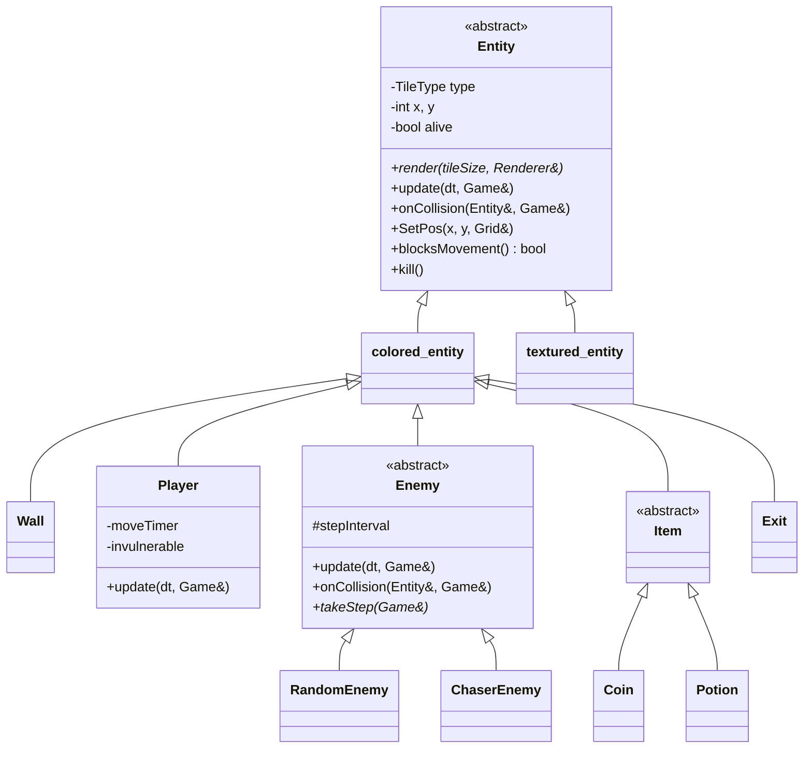
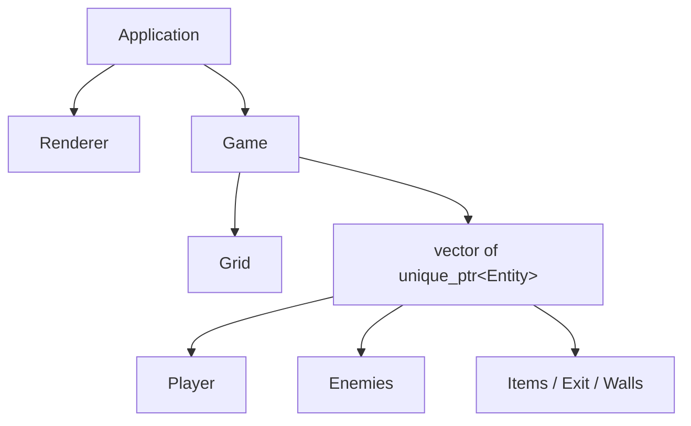

# PATH QUEST


A top-down, tile-based dungeon game written in **C++17** on top of a small custom 2D grid engine (Sokol + OpenGL). Collect every coin, dodge the enemies, and reach the exit.

Built as an **Object-Oriented Programming (OOPS) project**: the whole game is organised around an abstract `Entity` base class, inheritance, and polymorphism.

<!-- TODO: add a screenshot or GIF here, e.g.  -->

---

## 🎮 Gameplay

Collect **all** the yellow coins on a level to unlock the exit, then walk onto it to advance. Touching an enemy costs a life. Lose all lives and it's game over; clear both levels and you win.

### Controls

| Key | Action |
|-----|--------|
| `W` `A` `S` `D` | Move up / left / down / right |
| `R` | Restart the game |

### What's on the map

| Colour | Object | Behaviour |
|--------|--------|-----------|
| 🟩 Green | **Player** | Moves one tile at a time; blinks for 1.5 s of invulnerability after being hit |
| 🟦 Blue | **Wall** | Blocks movement |
| 🟨 Yellow | **Coin** | +10 score. All coins must be collected to unlock the exit |
| 🟪 Pink | **Potion** | +1 life |
| 🟥 Red | **Random enemy** | Wanders in random directions |
| 🟧 Orange | **Chaser enemy** | Walks toward the player |
| ⬜ Grey → 🟩 Green | **Exit** | Grey while locked, green once all coins are collected |

**HUD** (drawn on the top wall): red squares on the left are your lives, yellow squares on the right are the coins still to collect. Score and events are printed to the console.

---

## 🛠️ Build & Run

The project currently builds on **Windows** (it links `opengl32` and `gdi32`).

**Requirements:** [CMake](https://cmake.org/) ≥ 3.15 and [MinGW-w64](https://www.mingw-w64.org/) (a C++17 compiler).

```powershell
# 1. Clone
git clone https://github.com/SHERLYSANJANA/OOPS_Project.git
cd OOPS_Project

# 2. Configure
cmake -S . -B build -G "MinGW Makefiles"

# 3. Compile
cmake --build build

# 4. Play
.\build\My2DGame.exe
```

> Added a new `.cpp` file? Re-run step 2 so CMake picks it up.

---

## 📁 Project Structure

```
OOPS_Project/
├── CMakeLists.txt
├── main.cpp                  # Entry point (hands control to the engine)
├── README.md
├── sokol/                    # Sokol single-file libraries (window, graphics)
│
├── engine/                   # Reusable 2D engine – the game never touches OpenGL
│   ├── core/
│   │   ├── Application.h/.cpp    # App lifecycle: init → frame → cleanup
│   │   ├── Input.h/.cpp          # Keyboard & mouse state
│   │   └── sokol_implement.cpp
│   ├── graphics/
│   │   ├── Renderer.h/.cpp       # Draws coloured / textured tiles
│   │   └── Texture.h/.cpp        # BMP texture loader
│   └── physics/
│       └── Collider.h/.cpp       # (reserved, currently empty)
│
└── game/                     # Everything specific to Coin Dungeon
    ├── Gridmanager.h/.cpp        # Grid: which tiles are blocked
    ├── entity.h/.cpp             # Entity base class + coloured / textured variants
    ├── entities.h/.cpp           # Wall, Player, Enemies, Items, Exit
    └── game.h/.cpp               # Game rules, levels, collisions, game state
```

The engine knows nothing about the game's classes. It only calls `Game::init()`, `Game::update(dt)` and `Game::render(renderer)`.

---

## 🧱 Architecture

### Class hierarchy



### Ownership



`Game` owns the `Grid` and every entity. Entities never own each other: when an enemy needs the player, it asks `game.getPlayer()`.

### One frame

1. `Application` calls `Game::update(dt)`.
2. `Game` loops over all entities and calls each one's own `update()` (the player reads input, enemies run their AI).
3. Movement goes through `Game::tryMove()`, which checks walls, lets colliding entities react via `onCollision()`, and triggers pickups on walkable tiles.
4. After the loop: newly spawned entities are added, dead ones (collected coins) are removed, and level changes are processed.
5. `Application` calls `Game::render()`, and every entity draws itself.

### Collision rules

| Mover → target | Result |
|----------------|--------|
| Anyone → wall / out of bounds | Blocked |
| Player ↔ enemy (either one moves) | Player loses a life, respawns at the start, gets 1.5 s immunity |
| Player → coin / potion | Pickup effect, item removed |
| Player → exit | Next level, only if no coins remain |

Only *blocking* things (walls, player, enemies) are stored in the grid. Coins, potions and the exit are walkable and are found by a lookup, so the player can stand on them.

---

## 🧠 OOP Concepts Used

| Concept | Where |
|---------|-------|
| **Abstraction** | `Entity`, `Enemy` and `Item` are abstract (pure virtual `render()` / `takeStep()`) |
| **Inheritance** | `Entity → colored_entity → Player / Wall / Enemy / Item / Exit`, and `Enemy → RandomEnemy / ChaserEnemy` |
| **Polymorphism** | `Game` calls `entity->update()` and `onCollision()` on a list of base-class pointers; each subclass behaves differently. `Enemy::update()` calls the virtual `takeStep()` |
| **Encapsulation** | Position, type and alive-state are private in `Entity`; `Grid` hides its tile array behind `isBlocked()` / `setTile()` |
| **Composition** | `Game` owns a `Grid` and the entity list; `textured_entity` owns its `texture` |
| **RAII / smart pointers** | `std::unique_ptr<Entity>` ownership; `~Entity()` automatically frees its grid tile |
| **Templates** | `Game::spawn<T>(args...)` creates any entity type |
| **Method overriding** | `render`, `update`, `onCollision` overridden throughout |

---

## 🗺️ Editing Levels

Levels are text maps at the top of `game/game.cpp`. Each must be **40 columns × 22 rows**.

| Char | Meaning |
|------|---------|
| `#` | Wall |
| `P` | Player start |
| `C` | Coin |
| `H` | Potion (+1 life) |
| `X` | Exit |
| `R` | Random enemy |
| `E` | Chaser enemy |
| `.` | Empty floor |

To add a level, add another `{ ... }` block of 22 strings to `LEVELS`. The game picks it up automatically.

## ➕ Adding a New Enemy

1. Declare the class in `game/entities.h`:
   ```cpp
   class SleepyEnemy : public Enemy {
   public:
       SleepyEnemy(int x, int y, Grid& board);
       void takeStep(Game& game) override;
   };
   ```
2. Implement `takeStep()` in `game/entities.cpp`. Use `game.tryMove(*this, dx, dy)` to move.
3. Give it a map character in `Game::loadLevel()`:
   ```cpp
   case 'S': spawn<SleepyEnemy>(x, y); break;
   ```

Nothing else changes: the update loop, collision handling, and rendering already work for any `Entity`.

---

## ⚠️ Known Limitations

- Windows-only build (CMake links Windows OpenGL libraries).
- Entities are coloured squares; `textured_entity` exists but no sprites are used yet.
- There is no on-screen text, so score and messages go to the console.
- `engine/physics/Collider` is an empty placeholder.

## 🚀 Possible Next Steps

Sprites and animations · sound · a title/pause screen · smarter chaser pathfinding (BFS) · more levels · a level editor using the mouse input already in the engine.

---

## 🙏 Credits

- Windowing, graphics and input via [**Sokol**](https://github.com/floooh/sokol) by Andre Weissflog.
- Team: _add your names here_

## 📄 License

_Add a license (for example MIT) if you plan to share this publicly._


Game Look:


